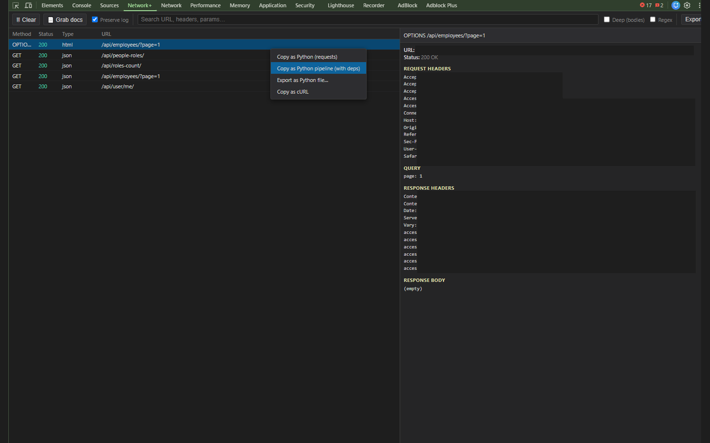

# Network+

A better Network tab for Chrome DevTools: capture, search, inspect, and export requests — including turning any captured request into ready-to-run **Python** code.

Network+ adds its own panel next to **Elements**, **Console**, and **Network** in Chrome DevTools. It's built for developers, testers, and API tinkerers who want to understand a page's traffic and reproduce it in a script fast.

## Features

- **Live capture** — every request the page makes shows up in a clean, filterable list (method, status, type, URL).
- **Preserve log** — optionally keep the list across page reloads and navigation.
- **Fast search** — instant search over URLs, headers, and query params.
  - **Deep search** — also search inside response bodies (fetched on demand).
  - **Regex** — treat your search term as a regular expression.
- **Grab docs** — capture the *rendered* HTML of the page and its same-origin iframes, so server-rendered values become searchable (the Network API returns empty document bodies otherwise).
- **Detail inspector** — view request/response headers, query string, request body, and a pretty-printed response body.
- **Export as Python (`requests`)** — right-click any request to copy a clean, parameterized Python function that reproduces it.
- **Export as Python pipeline** — generate a multi-step script that traces how a value (a token, id, session, …) was produced by an **earlier** response and wires it through automatically. Handles bearer tokens, JSON paths, response headers, and cookies (via a shared `requests.Session`).
- **Export as cURL** — copy any request as a `curl` command.
- **Export capture** — save the whole session as a `.har` file.

## Install

### From the Chrome Web Store
*(link will go here once published)*

### From source (Load unpacked)
1. Download or clone this repo.
2. Open `chrome://extensions`.
3. Enable **Developer mode** (top-right).
4. Click **Load unpacked** and select this folder.
5. Open DevTools (F12) on any page — you'll see a **Network+** tab.

> Note: with *Load unpacked*, Chrome reads directly from this folder. If you move or delete the folder, the extension stops working — re-run *Load unpacked* on the new location.

## Usage

1. Open DevTools → **Network+** tab.
2. Browse/interact with the page; requests appear live.
3. Click a row to inspect it. Right-click a row for export options.
4. Use the search box (toggle **Deep** to search bodies, **Regex** for patterns).
5. Use **Grab docs** to make server-rendered HTML searchable.

### Copy as Python
Right-click a request → **Copy as Python (requests)** gives you a standalone function. **Copy as Python pipeline (with deps)** gives you a `main()` that calls the dependency chain in order, re-extracting dynamic values from earlier responses instead of hardcoding stale ones.

## Privacy

Network+ runs entirely in your browser. It does **not** send your data anywhere — no servers, no analytics, no telemetry. See [PRIVACY.md](PRIVACY.md).

## Permissions

Network+ requests **no host permissions** and no broad Chrome permissions. It operates only within the DevTools session you have open, using the standard `chrome.devtools` APIs. It can read request/response data and page content **only for the tab whose DevTools you opened**, and only while DevTools is open.

## License

[MIT](LICENSE)
